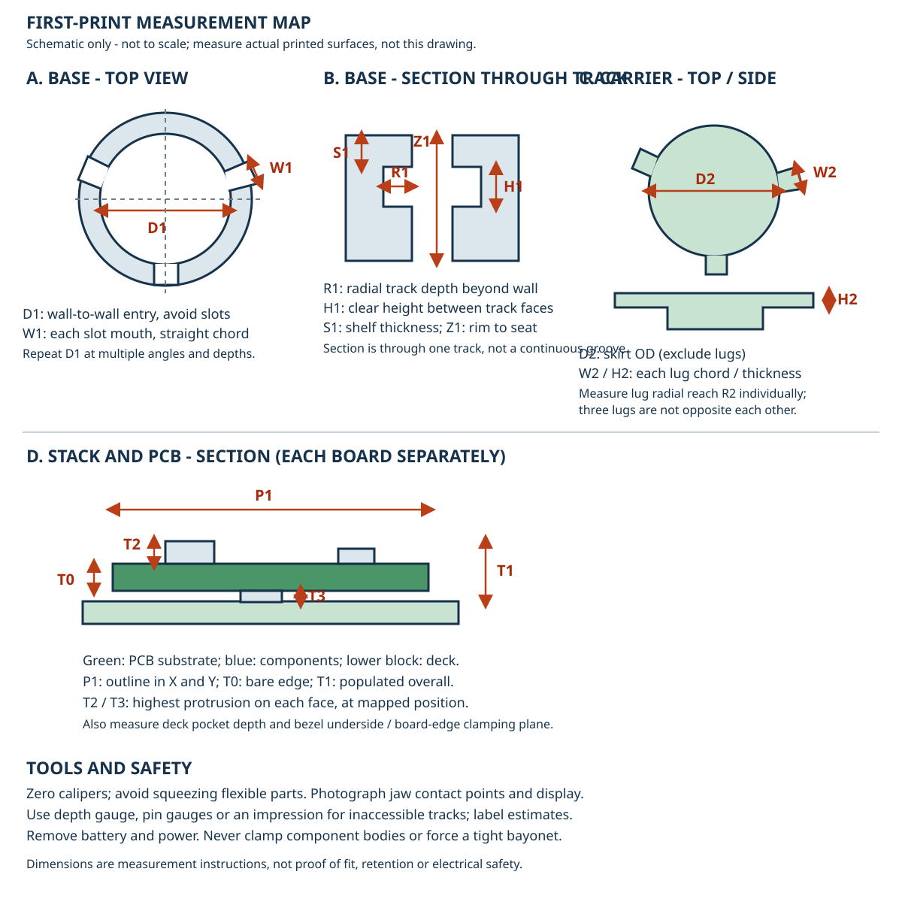

# First-print fit roadmap

**Status: measurement and battery-free fit study, not a qualified ring.** The
original printed cassette was reported too tight for the base. The current
CR2032 design and experimental smaller-cell parts are not physically qualified.
Do not force parts together, insert a cell, power them or wear them during
these checks.

The drawing is an **illustrative schematic, not to scale or a photo of the
print**. The three lugs are spaced 120 degrees apart: do not treat a measurement
across two lug tips as a true tip-to-tip diameter. Labels below identify actual
surfaces to measure, not dimensions inferred from the illustration.

## What is known

| Observation | Value | Provenance and qualification |
| --- | ---: | --- |
| Entry to opposite wall without a bayonet slot | **22.1 mm** | User-reported single span; the socket is not yet surveyed for roundness, depth or track geometry. |
| Apparent opening / carrier outside | 21.3 / 23.0 mm | Read from the user-supplied [first-print photo album](https://photos.google.com/share/AF1QipOd3DbqC0dKsuZZWue2C9UtuONsv4OKJqO37KWt2WNl0XEDDrqsBUkkBqgSo27LWA?pli=1&key=RlZWaVVWTmR1SzVMV2Q0M1owMHI0MW9VckxfODVB); exact jaw-contact features are not confirmed. |
| Populated mono / IR overall height | 1.6 / 2.4 mm | User-reported board **plus components**; component side and locations not established. |
| Original / revised carrier skirt | 23.0 / 22.5 mm | Nominal CAD, not measured revised prints. The revised skirt exceeds the reported 22.1 mm span. |
| Experimental gauge skirt | 21.5 mm | Nominal CAD, not printed or proven to fit; its lugs assume the original CAD track. |
| Mono / IR substrate | 0.8 / 1.6 mm | Saved KiCad values, not separate physical thickness measurements. |

With the specified 0.15 mm cell clearance and 1.05 mm nominal wall, the existing
20 mm CR2032 well needs at least **22.4 mm outside diameter**, before insertion
clearance. If 22.1 mm is a controlling entry span, merely shrinking that well
is not viable. A smaller cell or a new base requires a new checked design.
The experimental CR1632-sized carrier is a battery-free fit study, not a
validated battery holder.

## Measurement procedure

1. Identify each item and revision: original print, material/process, print
   orientation, supplier, post-processing and date; label the base and carrier.
   Record caliper model, displayed resolution, zero check, units and any
   measurement uncertainty. Record individual readings, not just averages.
2. Remove the battery and disconnect power. Gently clean loose powder without
   altering mating faces. Do not bend the band or squeeze thin walls with jaws.
   Photograph each reading with the jaw tips and display visible. If a feature
   cannot be reached, record **not measured**; do not infer its size.
3. Measure the base entry at several angles and at the rim and deeper positions,
   staying on wall surfaces rather than slots. Repeat each direction; record the
   smallest result and any out-of-roundness. For inaccessible track faces use a
   suitable depth probe, pin gauges or a removable impression; identify the
   method and its uncertainty. Do not cut the only printed part.
4. Measure all three slot mouths and carrier lugs separately, including the
   wider key. Record their orientation relative to the wide slot and the rim,
   the chord positions and heights. Check for roughness, flash or deformation.
5. Measure both unpowered boards separately. At a bare edge measure substrate
   thickness without pressing components; measure overall populated height and
   protrusions on each face at their positions. Record outline width and height,
   deck pocket depth and bezel contact height. The overall height alone cannot
   determine clamping plane or component clearances.

### Measurement sheet

Use millimetres. Record sample ID, direction, height, instrument, uncertainty
and photo for each result; leave unmeasured entries blank. Negative clearance
means interference, but only compare dimensions taken at corresponding
heights and directions.

| ID | Measure on the current print | Reading(s) / location / photo |
| --- | --- | --- |
| D1 | Minimum entry wall-to-wall span excluding slots; at least three orientations and two depths | 22.1 reported; repeat and map |
| W1 | Straight chord across **each** slot mouth, wide and two narrow; identify each | |
| R1 | Radial distance from socket wall to back of each track | |
| H1 | Vertical clear distance between floor and underside of each retaining shelf | |
| S1 | Thickness of each retaining shelf between its top and track underside | |
| Z1 | Entry rim to bottom seating surface; repeat around circumference | |
| D2 | Carrier skirt outside diameter excluding lugs, at corresponding D1 heights and angles | |
| W2 | Chord width of each lug at its outer end; identify wide lug | |
| H2 | Axial thickness of each lug; repeat at both ends | |
| R2 | Radial lug reach: lug tip radius minus local skirt radius; record method | |
| Z2 | Carrier underside to lug bottom and top; compare to the base seat and track | |
| P1 | Each PCB outline width/height and corner profile; note contact orientation | |
| T0 | Each **bare PCB substrate** thickness at a clear edge | |
| T1 | Each populated board overall height, specifying points touched | 1.6 mono / 2.4 IR reported |
| T2 / T3 | Maximum component protrusion above front / rear substrate face and XY location | |
| P2 | Deck pocket width, depth and seat height; bezel lip/clamping height and screw post heights | |
| C1 | Cell actual OD and height, negative-face diameter and contact position, if a cell is later selected | |

For each measured direction, D1 minus D2 is the *diametral* entry gap;
half is a radial estimate only if the surfaces are concentric and circular.
For each slot, compare W1 and W2 as **chords at the same radius**, not angles
and chords interchangeably. Compare H1 with H2 and Z1/Z2 to identify axial
interference. R1 and R2 describe radial reach but do not alone prove entry,
engagement, safe retaining overlap or release. Quantify uncertainty and
worst-case min/max rather than assuming a single reading is a process tolerance.

## Decisions and next gates

1. **Characterize the existing base.** Complete D1/W1/R1/H1/S1/Z1 and compare
   to D2/W2/H2/R2/Z2. Mark which surface actually binds during a gentle,
   battery-free attempt; never force the current 22.5 mm nominal skirt.
2. **Print the test pieces if useful.** The separate
   [`BayonetGauge.stl`](../generated/fit_gauges/BayonetGauge.stl) tests the
   21.5 mm candidate skirt with original-CAD lug assumptions. The
   [`BoardOutlineGauge.stl`](../generated/fit_gauges/BoardOutlineGauge.stl)
   tests both saved board outlines only. Measure each as printed and record
   entry, travel, rotation, release and contact marks. No test establishes
   lock strength or tolerances from one sample.
3. **Choose and redesign the battery stack.** If the physical opening remains
   limiting, evaluate a real smaller standard cell and its negative-face
   geometry, or redesign the base. Recalculate both pogo mount positions,
   working stroke and worst-case tolerance; maintain rim insulation and all
   minimum print walls. Do not substitute or scale a cell solely to pass CAD.
4. **Design each board's clamp and wiring.** Use actual board outlines, bare
   thicknesses and populated envelopes; ensure bezel edge capture, screw
   clearance, front ground routing and rear VCC access. The IR prototype bezel
   lacks a verified ground-wire relief and its U2 3D model was unavailable.
   Common power topology is not proof of interchangeable contacts.
5. **Validate and iterate.** Run CAD insertion/twist, wrong-key rejection,
   pullout, contact-stack, interference and STL wall checks on the actual
   revised design; regenerate native/exported CAD and media. Then measure
   representative prints and conduct retention, cycling, drop, contact
   resistance, loaded current/temperature, short and cell safety tests before
   any wearable use. CAD and single-print gauges cannot establish reliability.

Share the filled sheet and corresponding photographs alongside part revision
and print details. Retain the original readings separately from CAD targets
and any subsequent fitted dimensions.
