# Ring IR programming clip

A solder-free in-system programming (ISP) clip for the
[`ring_pcb_IR`](../ring_pcb_IR) ATtiny85 board. Spring-loaded pogo pins press on
the board's rear test pads, held by a hinged clip like
[Adafruit 5434](https://www.adafruit.com/product/5434) but with pin spacing
matched to the ring. The parts are the jaws, spring and hardware from the
[AliExpress DIY pogo clip kit](https://www.aliexpress.com/item/1005006153573416.html),
with its generic guide PCBs replaced by the boards here.

> **Status: kit physically assembled; custom IR adapter still virtual.**
> ERC and DRC pass with zero violations of any severity. The FreeCAD fit check
> passes against a clip model built from **photo and datasheet estimates**,
> because the seller publishes no drawing. The AliExpress kit has now been
> assembled and photographed with calipers. The new reconstruction below uses
> readable measurements, but mounting geometry and spring travel remain estimates.
> The custom probe/anvil/fence boards have not been physically fitted or used
> to program a ring. The original PCB fit report retains its estimated inputs.

## Kit assembly animation

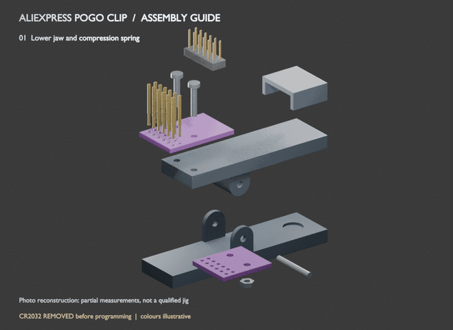

[Assembly video (MP4)](generated/assembly/clip_assembly.mp4) shows the lower jaw,
compression spring, upper jaw, hinge, grip block, guide/probe PCBs, screws/nuts,
pogo pins and header coming together, separating, and opening at the hinge.
The main assembly/explosion now uses the **actual custom IR adapter with SMD
header**, not a generic stock probe. A separate comparison shows
**1.27, 2.00 and 2.54 mm** stock-grid studies.
Fine-pitch pins require different guide drills; do not force large pins into them.
The flights apart identify parts, not a collision-verified tool-access sequence.
The final segment shows the **actual KiCad IR PCB copper, solder-mask openings
and silkscreen**, lifted clear for inspection and then seated LEDs-down in the
custom adapter. Component boxes remain clearance envelopes, not detailed package
models.

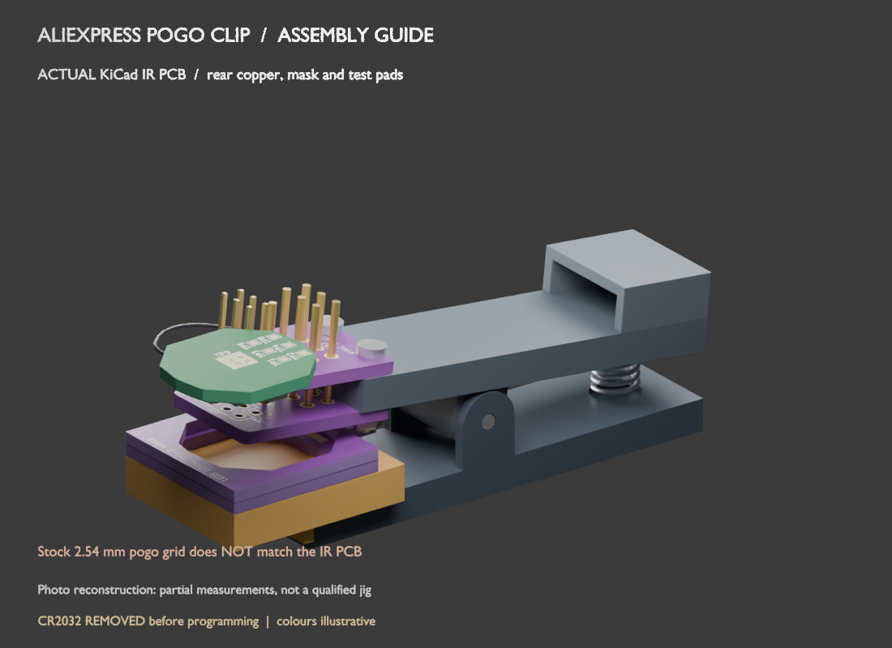

The custom-adapter segment separates the **actual probe, second probe/guide,
anvil and fence PCBs**, using KiCad-exported STEP substrates and the actual
top-side **SMD 2x3 male header** model, with KiCad copper, mask and silkscreen.
Its 2.54 mm mating posts accept female Dupont programming leads; there are no
header tails projecting below the probe. The pogo pattern remains unchanged.
The black service loop shows the required ground connection:
**ISP J1.6 → probe J2 → insulated wire → anvil J1 → ENIG P8 → front TP8**.
Its flexible shape is illustrative, not a cable-clearance simulation.
PB3/PB4 remain spare, unconnected positions on the probe.

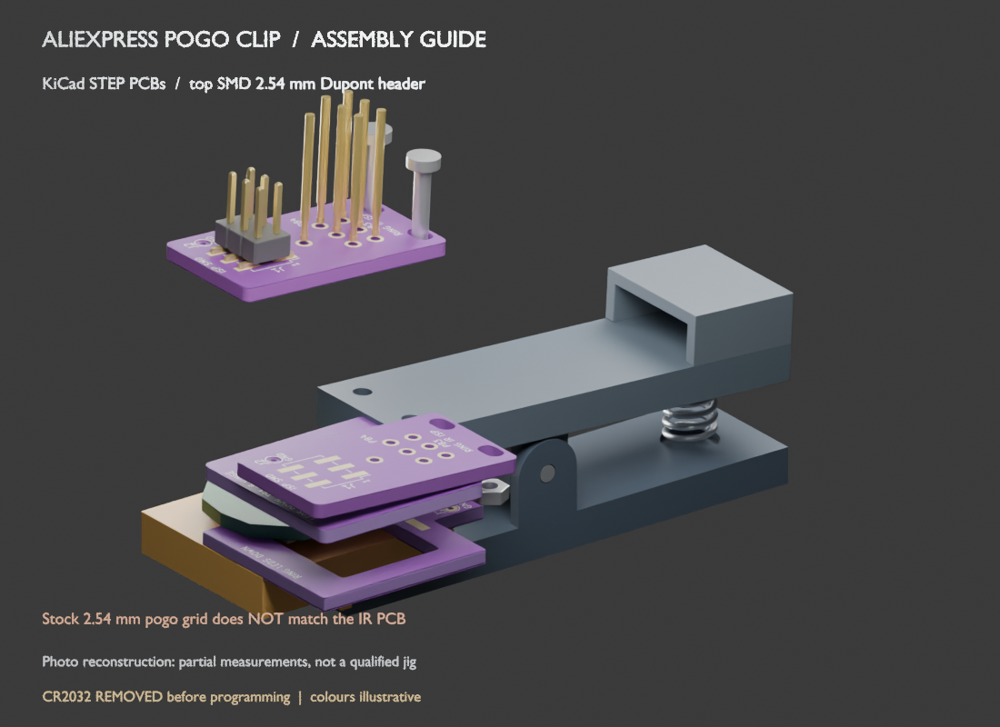

**A stock 2.54 mm pogo grid is not a direct match to this IR board.** Its signal
test pads are on a **3.05 mm grid**, VCC is off-grid, and ground is on the front.
The 2.54 mm AVR ISP *header* pitch must not be confused with pogo spacing.
FreeCAD places a centred 2.54 mm grid optimistically over six pads: outer pin
centres miss by 0.51 mm across and 0.255 mm along the rows (0.570 mm diagonally).
The outer tip faces overlap only about 40% of the nominal pads; this is not
a dependable contact. Extra stock pins and wiring are not assumed safe.
Use the custom seven-pin probe/guide plus the front-ground anvil, not stock PCBs.
Rechecked directly with KiCad's board API: TP1/TP3/TP5 X coordinates are
139.6004/136.5504/133.5004 mm; TP1/TP2 Y coordinates are
115.7986/118.8486 mm. Both differences are **3.0500 mm**. Pads are 1.00 mm square,
so the edge-to-edge gap is 2.05 mm, not 2.54 mm. The reported approximately
2.5 mm physical reading does not match these centre coordinates; confirm the
physical board revision and repeat across multiple centres before changing
the manufactured adapter. The PCB and pad positions have not been altered.

The reconstructed body passes solid/STEP round-trip, all-pair static collision
and 13-position hinge-opening checks for each variant (0 to 6 degrees).
Estimated spring geometry is compressed at each pose and checked for jaw
interference and coil spacing; this is **not** a force or fatigue simulation.
The custom pins nominally cover their pads, but a 0.9 mm tip on a 1 mm pad has
only **0.05 mm** edge margin: physical registration still needs qualification.
Threads, solder joints, spring-end seating and cable clearance are not resolved.
The IR adapter retains the earlier unmeasured P75 length/travel assumptions;
the album's 14.0/16.4 mm loose pins are not interchangeable without a stack rebuild.

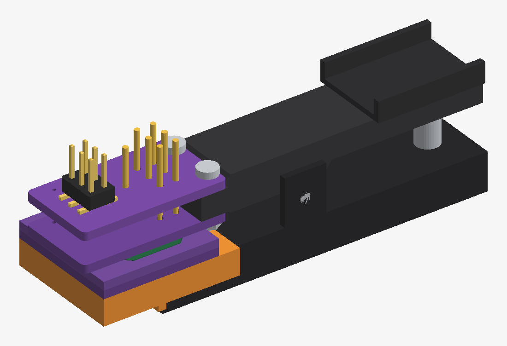

| Probe (pin side up, two stacked) | Probe (ring side) | Anvil (lower jaw) | Fence (locator) |
| --- | --- | --- | --- |
| 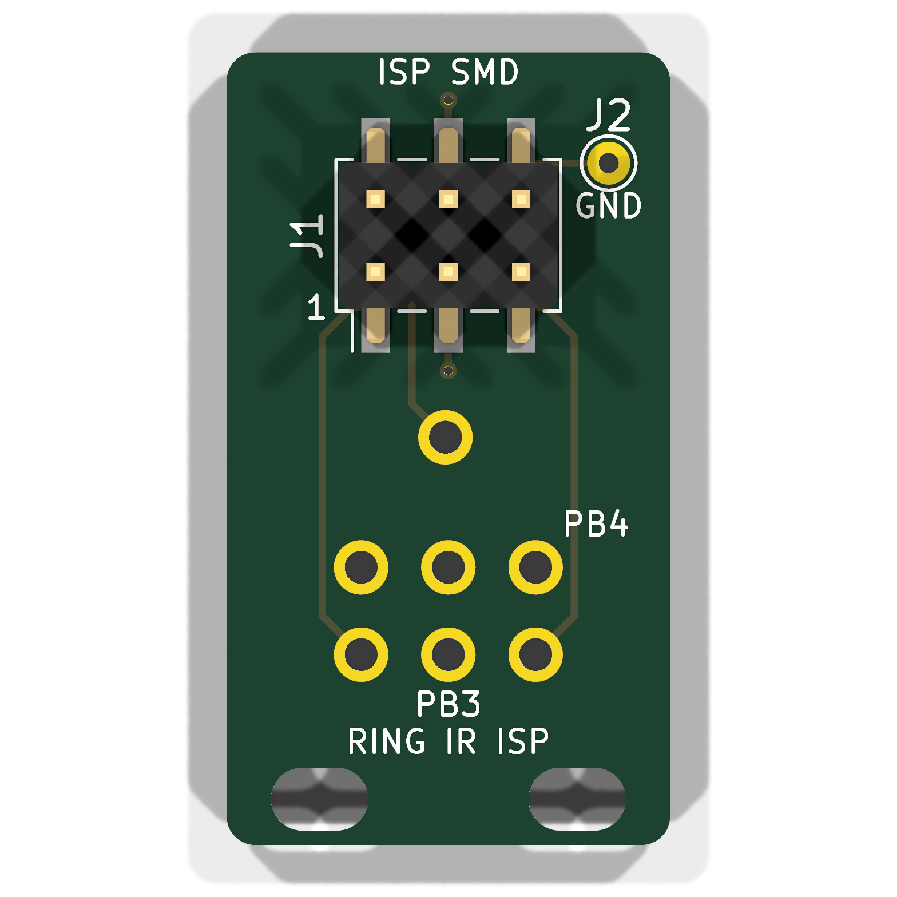 | 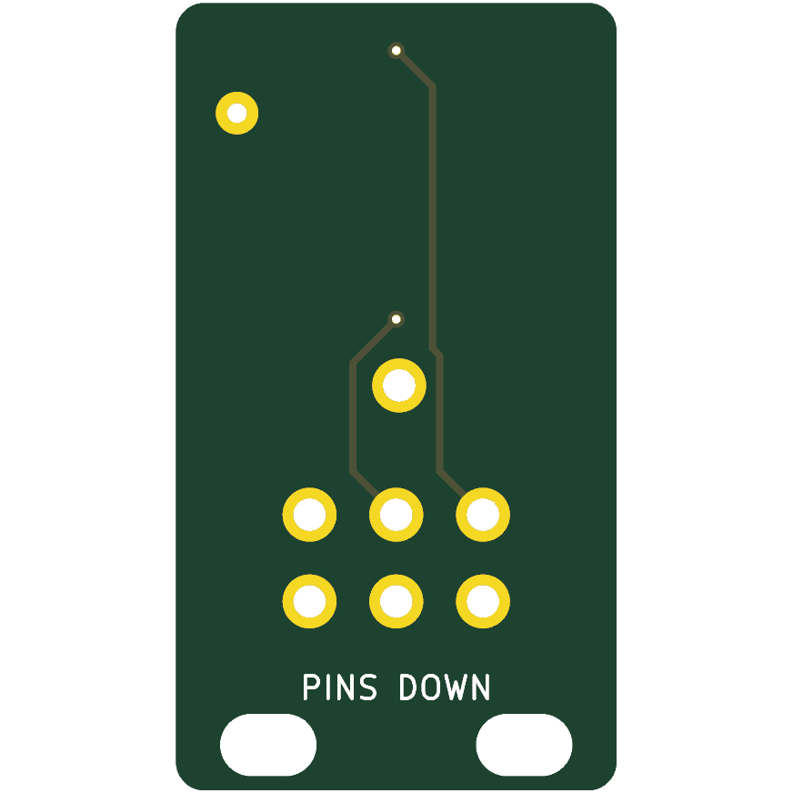 | 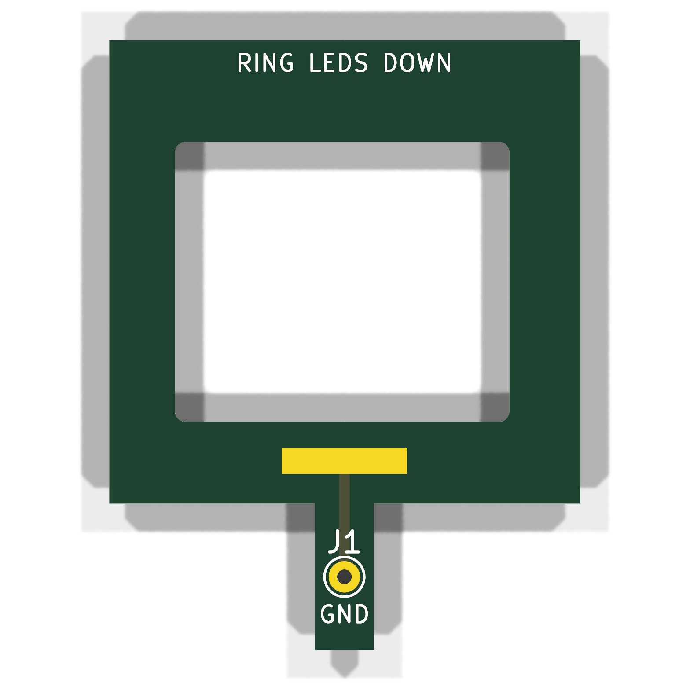 | 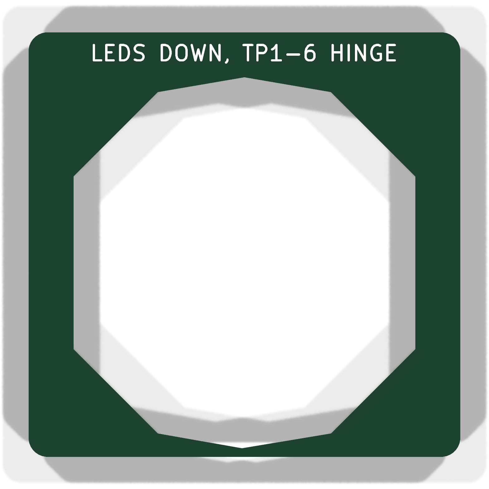 |

### Current 2D board drawings

| Board | Front | Rear (mirrored viewing side) |
| --- | --- | --- |
| Probe / guide | [Copper + silk SVG](generated/ring_ir_prog_probe_top_2d.svg) | [Copper + silk SVG](generated/ring_ir_prog_probe_bottom_2d.svg) |
| Anvil | [Copper + silk SVG](generated/ring_ir_prog_anvil_top_2d.svg) | [Copper + silk SVG](generated/ring_ir_prog_anvil_bottom_2d.svg) |
| Fence | [Outline + silk SVG](generated/ring_ir_prog_fence_top_2d.svg) | [Outline SVG](generated/ring_ir_prog_fence_bottom_2d.svg) |

[Probe schematic](generated/ring_ir_prog_probe_schematic.pdf) and
[anvil schematic](generated/ring_ir_prog_anvil_schematic.pdf) are also regenerated
from the current design. The SVGs are review drawings, not fabrication files.

## How it works

For bare-board fabrication, use the
[Elecrow quotation package](fab/elecrow/README.md): three separate PCB jobs,
with two identical probe/guide boards, one GND-contact anvil and one fence per
clip. It excludes all parts, assembly and stencils.

All components on the ring are on the front, so the rear is flat. The ring
goes into the clip **LEDs down**:

```
  header  pins           probe PCB (on top of the upper-jaw tip)
  ┌┴┐  ││ ││ ││ ┌───────┐ ← M2 screw through the jaw holes and both slots
 ═╧═╧══╪╪═╪╪═╪╪═│ upper │══  probe
       ││ ││ ││ │  jaw  │
 ══════╪╪═╪╪═╪╪═└───────┘══  guide (second probe board, unpopulated)
 ══════ ring_pcb_IR (rear up, LEDs down) ═══╗ ← pins land on TP1–TP6 + TP9
 ─fence─[ pocket locates the ring ]─fence─  ║ nut
 ─anvil─[ window clears parts ]▄ GND pad ─anvil──── tail (GND lead)
 ▓▓▓▓▓▓▓▓▓ printed riser (5 mm) ▓▓▓▓▓▓▓▓▓▓▓▓
         ▓ hook ┌──────── lower jaw ─────────
```

- **Probe board** (15.5 × 27.7 mm, the jaw width). Order two identical boards.
  They sandwich the upper-jaw tip, as on Adafruit 5434: the populated probe on
  top, the unpopulated copy underneath as a pin guide resting on the ring. Two
  M2 slots go through both boards and the jaw holes; the slots absorb the
  unmeasured hole spacing (7.8–10.2 mm). Seven P75-class pins are mirrored onto
  TP1–TP6 (3.05 mm grid) and TP9. TP9 is the VCC test point at the centre of
  the exposed battery pad. The pins are routed to a standard AVR ISP-6 header
  (J1) and a GND lead pad (J2). The header sits **in front of** the pin grid,
  so the jaw tip can sit just behind the pins and close over the ring.
  The top-side SMD header requires longer solder lands than the old through-hole
  header, so the front edge extends 5 mm further; pogo centres and jaw slots
  have not moved. Its mating posts remain on a 2.54 mm grid, while the splayed
  SMD solder-land rows are 5.05 mm apart. The lower guide has no header fitted.
- **Anvil board** (22.5 × 29.2 mm). Taped to the printed riser. A window
  clears every front courtyard. The ring rests on its side rails, the top band
  and a flat ENIG GND pad under the exposed front ground bar (TP8). A narrow
  tail pad (J1) takes the GND lead between the M2 nuts.
- **Fence board** (22.5 × 22.2 mm). Stacked on the anvil. Its pocket is the
  ring outline plus 0.15 mm, so the ring drops in at a fixed position. Its
  rear edge stops 0.6 mm past the ring so the M2 nuts clear it.
- **Riser** (printed). Lifts the anvil 5.0 mm, so
  the stack matches the 9.8 mm parallel jaw gap and the jaws close parallel.
  A hook drops in front of the lower-jaw tip to stop the stack sliding.
- **GND lead.** A short 30 AWG wire runs from probe J2 to anvil J1. GND is only
  on the ring's front, so it cannot be reached from the pogo side.

The probe layout matches the IR board's test-pad positions, electrical nets,
outline and component clearances. See [development.md](development.md) for
engineering source and regeneration details.

### Pin map

See [programming-clip wiring](programming.md) for the board-top connector
orientation, complete IR ISP cable map, ground lead, power checks and first
signature read, plus the requirements for a different ISP or SWD target.
The current IR probe is AVR ISP only; it is not a pin-compatible SWD adapter.

| Ring pad | Net | ATtiny85 function | ISP-6 pin |
| --- | --- | --- | --- |
| TP1 | PB0 | MOSI | 4 |
| TP2 | PB1 | MISO | 1 |
| TP3 | PB2 | SCK | 3 |
| TP6 | PB5 | RESET | 5 |
| TP9 | VCC | VCC | 2 |
| TP8 (front bar, via anvil) | GND | GND | 6 |
| TP4, TP5 | PB3, PB4 | spare GPIO (MCU and test pad only) | not routed; probe at the pin tops or omit the pins |

ISP-6 is the standard Atmel 2×3 2.54 mm layout (pin 1 MISO, 2 VCC, 3 SCK,
4 MOSI, 5 RESET, 6 GND), so USBasp, AVRISP mkII, Arduino-as-ISP and similar
programmers plug straight in. A ring inserted 180° the wrong way is harmless:
VCC still lands on the central pad, the signal pins land on solder mask, and
GND reaches the other bar.

## Clip dimensions (estimated)

The AliExpress listing has photos only. Dimensions come from the Adafruit 5434
datasheet (`C17220-001`, same clip family) and from its photos scaled by a US
quarter and the 2.54 mm header pitch. The two scales agree within about 3%.
The estimates carry ±1.0 mm uncertainty. Frame: x from the lower-jaw tip
toward the hinge; heights from the lower-jaw top.

| Dimension | Estimate | Source |
| --- | --- | --- |
| Overall length | 62.5 mm | Datasheet p8 drawing |
| Jaw width | 15.5 mm | Front photo, header-pitch scale |
| Lower jaw: tip thickness / tip length / throat thickness | 4.4 / 12.7 / 7.3 mm | Side photo |
| Upper-jaw tip setback from lower tip | 7.5 mm | Side photo |
| Upper jaw: tip thickness / tip section end / mid thickness | 4.4 / 12.7 / 7.0 mm | Side photo |
| Parallel jaw gap at the tip (clamped) | 9.8 mm | Side photo, Adafruit stack clamped |
| Gap at the throat | 5.6 mm | Side photo |
| Hinge pin | x ≈ 27.5 mm (about 47% of length) | Side photo, AliExpress image 6 |
| M2 holes in the upper-jaw tip | 2 across the width, ≈ 9 mm apart, ≈ 3.5 mm behind the tip | AliExpress image 6, Adafruit photos |
| Spring / U-block | x ≈ 56.5 / 41.5–62 mm | Side photo (visual only) |
| P75 pin | 16.5 mm long, 1.02 mm barrel, 2.5 mm travel | Datasheet p13–14 |

## FreeCAD fit check

The virtual fit check builds a parametric assembly of the following parts:

- the clip jaws, hinge, spring and U-block;
- the riser;
- the anvil and fence;
- the ring with component height boxes;
- the guide and probe boards;
- seven pins at working compression;
- the header;
- the M2 screws and nuts.

It runs boolean interference checks on each part pair (33 pairs touch) and
checks contacts and clearances, then sweeps each clip estimate by ±1 mm.
Detailed fit-check information is in [development.md](development.md).

| Clamped (section at u = 0) | Exploded stack |
| --- | --- |
| 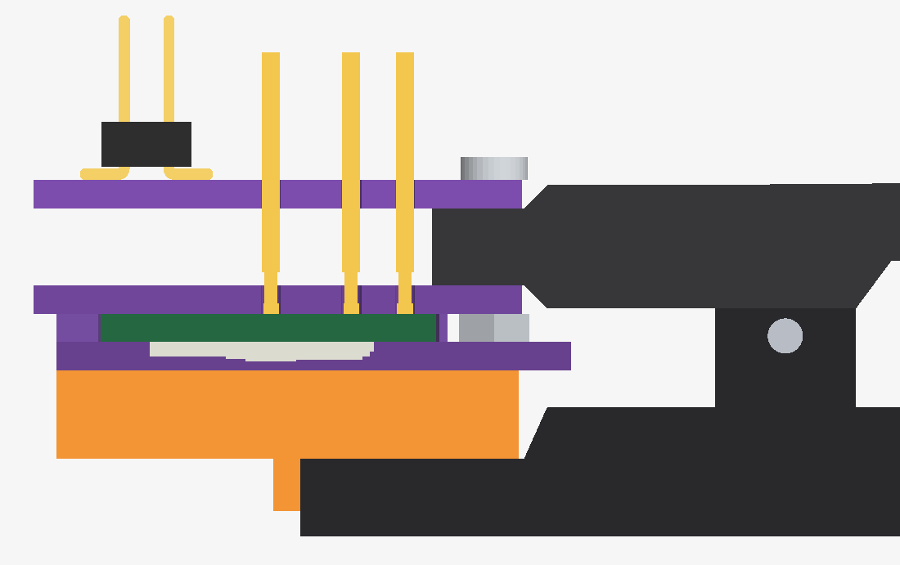 | 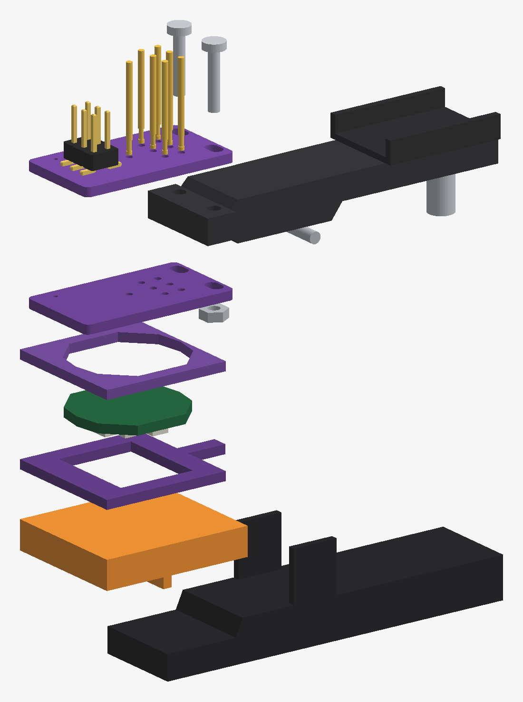 |

Results at the nominal estimates:

| Check | Result |
| --- | --- |
| Interference between any two parts | none |
| Contacts (riser–jaw, guide–ring, jaw–guide, probe–jaw, pins–ring) | all touching, 0.000 mm |
| Stack (riser / anvil / ring / guide / jaw / probe top) | 5.0 / 6.6 / 8.2 / 9.8 / 14.2 / 15.8 mm |
| Jaw tilt at the clamped gap | 0.0° (riser sized to the parallel gap) |
| Pin compression | 1.65 mm, 66% of 2.5 mm travel |
| Pin position against the TP pad centres | 0.000 mm |
| Pin barrel to upper-jaw tip | 1.04 mm |
| Probe end to the upper-jaw step | 0.10 mm |
| M2 nut to fence/anvil; screw tip above riser | 0.65 mm; 0.80 mm |
| Ring parts to riser (inside the anvil window) | 0.35 mm |
| Header below-board tails | none (top-side SMD) |
| Ring rear edge to the lower-jaw throat | 4.95 mm |

The ±1 mm sweep shows which dimensions to measure first:

- **Hole setback +1 mm or upper-tip setback +1 mm.** The probe end reaches the
  upper-jaw step. With the setback +1 mm the barrel also nears the jaw tip.
- **Upper tip section 1 mm shorter.** Same probe-end conflict.
- **Lower tip 1 mm shorter.** The riser end reaches the throat ramp.

All other ±1 mm cases still pass. The VCC pin sits 1.6 mm in front of the
lower-jaw tip; the riser carries that load.

## BOM

| Qty | Part | Notes |
| --- | --- | --- |
| 2 | Probe PCB, 1.6 mm | `fab/ring_ir_prog_probe.zip`; top is populated, the second is the pin guide |
| 1 | Anvil PCB, 1.6 mm, ENIG | `fab/ring_ir_prog_anvil.zip`; ENIG for the flat GND contact |
| 1 | Fence PCB, 1.6 mm | `fab/ring_ir_prog_fence.zip`; stack two for a deeper pocket if needed |
| 7 | P75-class pogo pin, 1.02 mm barrel | B1 spear or LM2 cone tip (head ≤ 1.05 mm, so it passes the 1.15 mm guide hole) |
| 1 | 2×3 2.54 mm SMD male pin header | Top probe only; use female Dupont leads, confirm matching SMD footprint |
| 1 | DIY pogo clip kit | Jaws, spring, M2 nuts |
| 2 | M2 × 10 pan-head screw | The kit's 12–16 mm screws are longer than the 9.2 mm grip and hit the riser |
| 1 | Printed riser | PLA or PETG, 100% infill |
| – | 30 AWG wire, VHB or double-sided tape | GND lead; holds the anvil/fence to the riser and the riser to the lower jaw |

## Before ordering: measure first

1. Measure the jaw with calipers and update the design settings. Start with the
   dimensions the sweep flags: the hole setback, the upper-tip setback and tip
   section length, the lower-tip length, the hole spacing, and the parallel
   gap with the clip closed on a 9.8 mm stack.
2. Measure the pogo pins: barrel diameter, length, travel and tip. Update the
   design settings, keeping the drill about 0.1–0.15 mm larger than the barrel.
3. Rebuild. The FreeCAD fit and the sweep must pass. The pins should reach
   the ring at about two-thirds of their travel when the clip is closed.

## Actual photos and measurements of AliExpress Clip

[Clip Programmer Assembly album](https://photos.google.com/share/AF1QipNwx2ELJVqs2tECPYQ5cwoX293osVatVeGoo2XyBIm2Dzrf3vpLs3F5LxYhLjrQvA?key=RVRZOGVPc3RqZ1FpdEt0eEJ4c1piN01uNm1QZm9n)
is the source for these kit photographs, not AI imagery.

| Kit parts laid out | Assembled kit |
| --- | --- |
| 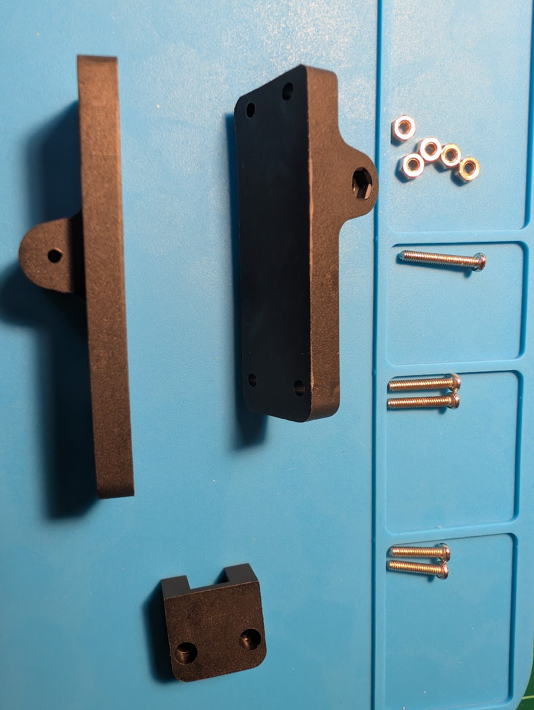 | 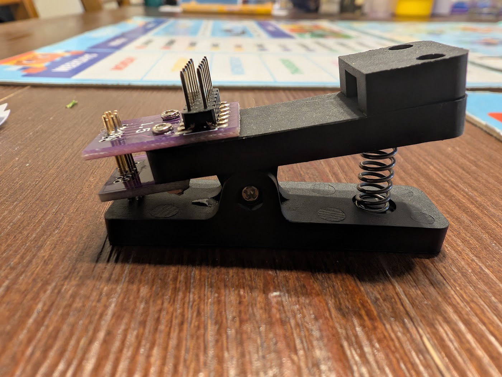 |

| Readable caliper measurement | Value | Qualification |
| --- | --- | --- |
| Body length | about 60.4 mm | multiple readings/angles; use +/-0.3 mm reconstruction uncertainty |
| Body/board width | 16.3 mm | photo 16; jaw contact points are partly obscured |
| Loose pogo lengths | 16.4 and 14.0 mm | photos 11/12; do not infer rated stroke |
| Thin shaft diameter | 0.6 mm | photo 9; not the large pin's barrel |
| Loose screw lengths | 11.0, 12.8, 14.9 mm | photos 4/6/13; under-head datum and screw roles unresolved |

Only these readings are treated as measurements. Hinge position, jaw profiles,
mounting centres, spring dimensions and pogo stroke are estimated. The stock
grid models are configurable illustrations, not reverse-engineered Gerbers
or certified drawings. The photographed stock PCB is labelled **1.5**; the
1.27/2.00/2.54 mm models are pitch studies, not claimed readings of that board.
The old estimated fit model remains separately documented.

| Reconstructed kit | Separated parts |
| --- | --- |
| 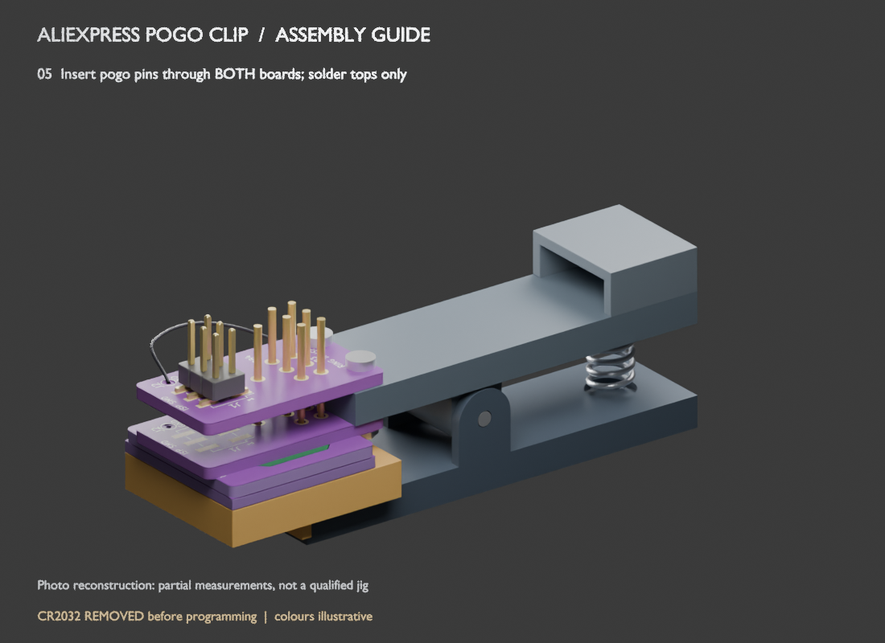 | 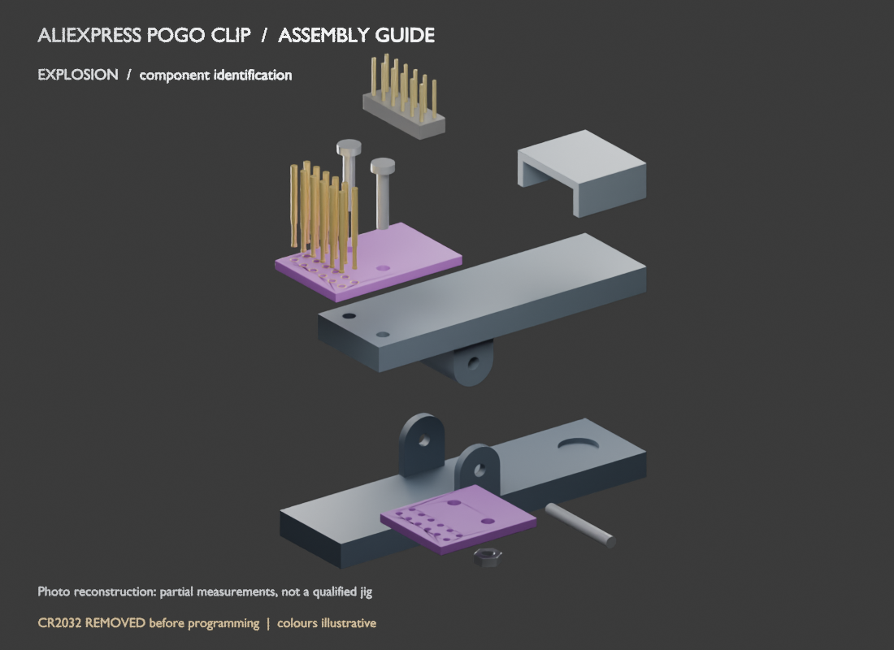 |

## Assembly

1. Reflow or hand-solder SMD J1 on the top probe board, checking all six joints.
   Solder the GND lead to J2. Leave J1 unpopulated on the lower guide.
2. Screw the probe (top) and guide (underneath) to the upper-jaw tip with
   M2 × 10 screws through the slots. Put the nuts under the guide.
3. Insert the pins tip first from the top, through the probe and the guide.
   Set them so the tips stand 1.65 mm below the guide. In the clamped stack
   that is 66% of travel, and the barrel ends 0.75 mm above the guide. Solder
   them on the top board only.
4. Tape the riser onto the lower jaw, with its hook against the jaw tip. Tape
   the anvil to the riser and the fence onto the anvil. Solder the other end
   of the GND lead to anvil J1.
5. Insert a ring LEDs down into the fence and close the clip. The guide comes
   down flat onto the ring and fence. Nudge the anvil stack until the programmer
   reads the ATtiny85 signature consistently, then tape it down.

## Safety

- **Remove the CR2032 before programming.** The programmer's VCC drives the
  ring's VCC directly, and backfeeding a primary lithium cell is unsafe.
- Use a 3.3 V or 5 V programmer within the ATtiny85 and LED limits, and keep
  current limited.
- Always insert LEDs down. Face-up insertion lets pins hit components.
- The unshrouded header is not keyed. Check pin 1 and every Dupont lead against
  the ISP table; provide cable strain relief so unplugging does not peel SMD pads.

## Development

KiCad/FreeCAD regeneration, validation and source-file details are in
[development.md](development.md).
