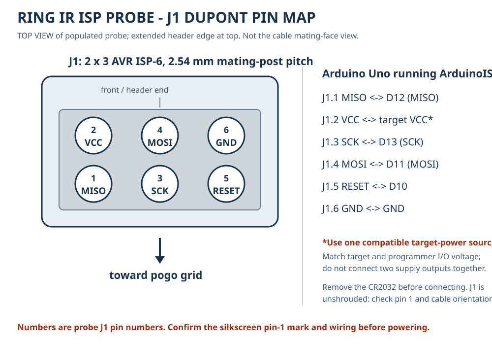
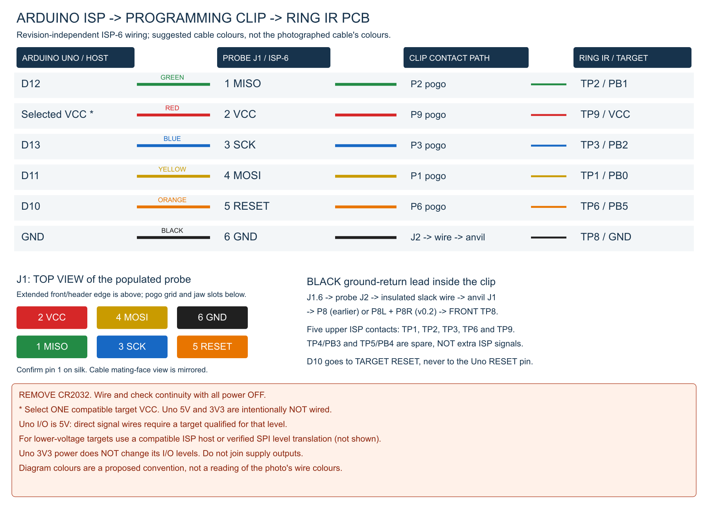
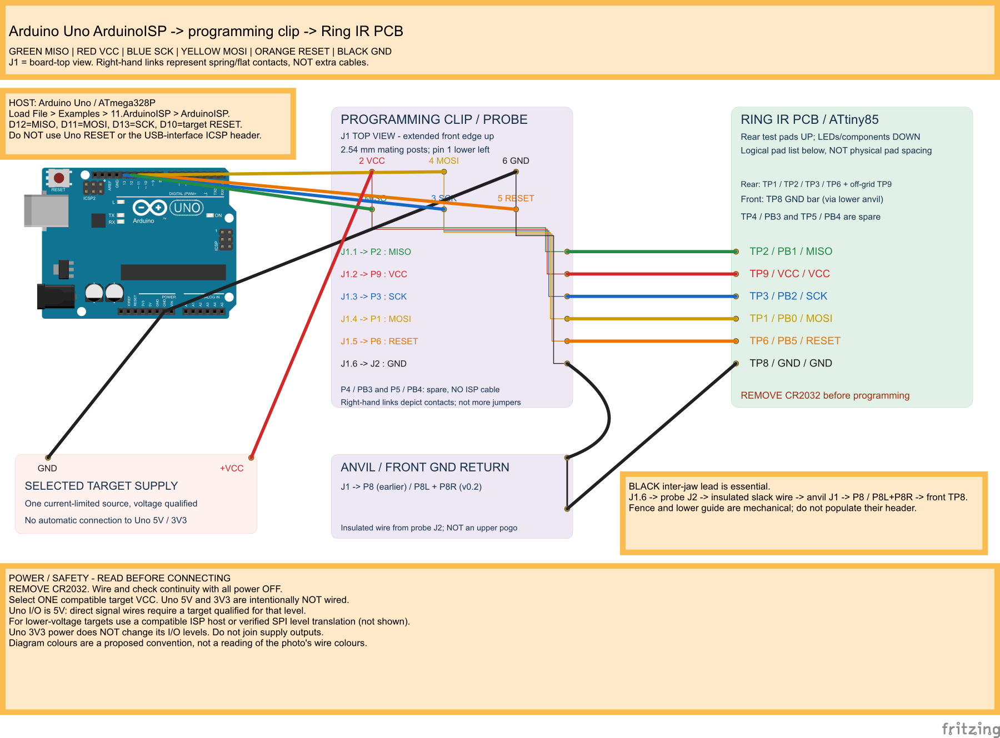

# Programming-clip wiring: AVR ISP and SWD

The clip is a passive contact fixture, not a programmer, voltage converter or
protocol adapter. The current probe is wired for the **ATtiny85 IR ring's
six-wire AVR ISP interface**. It does not give that MCU SWD support.
The user reports the custom clip has been built and its physical fit tested.
That report does not establish repeatable electrical contact or successful
programming. Other PCBs need their own verified pad pattern, signal mapping and
clearances.



## Colour-coded ArduinoISP harness



[Full-size SVG reference](harness/wiring-reference.svg) |
[Editable Fritzing sketch (.fzz)](harness/arduino_isp_harness.fzz) |
[Fritzing breadboard SVG](harness/arduino_isp_harness_breadboard.svg) |
[Fritzing schematic SVG](harness/arduino_isp_harness_schematic.svg).
The `.fzz` bundles the custom interface parts; open that file in Fritzing.



Use the following **suggested colour convention** for six female Dupont leads.
It is not a claim about the existing photo's cable colours. Label both ends
with the signal and J1 number; use continuity rather than colour alone.

| Colour | Arduino Uno running ArduinoISP | Clip probe J1 | Contact path to Ring IR |
| --- | --- | --- | --- |
| Green | D12 / MISO | 1 / MISO | P2 -> rear TP2 / PB1 |
| Red | One selected, compatible target-VCC source | 2 / VCC | P9 -> rear TP9 / VCC |
| Blue | D13 / SCK | 3 / SCK | P3 -> rear TP3 / PB2 |
| Yellow | D11 / MOSI | 4 / MOSI | P1 -> rear TP1 / PB0 |
| Orange | D10, **not Uno RESET** | 5 / RESET | P6 -> rear TP6 / PB5 |
| Black | GND, shared with the target supply | 6 / GND | Probe J2 -> insulated wire -> anvil J1 -> front TP8 |

Use **black** for the separate inter-jaw GND lead too. Earlier anvils use P8;
v0.2 uses P8L and P8R on the same GND net. This mechanical/contact-pad revision
does **not** change the six-pin harness. The fence and unpopulated guide need
no ISP cable, and TP4/PB3 and TP5/PB4 are not extra ISP connections.
In the Fritzing views the five right-hand coloured links mean **pogo-to-pad
contacts**, not five additional loose wires; the lower black link means the
flat anvil-to-front-TP8 contact. The interface blocks are logical drawings,
not pad-spacing templates or fabrication designs.

**Power is deliberately a selection, not an automatic Uno 5 V connection.**
A normal Uno has **5 V I/O**, even when its 3V3 pin supplies the target.
Direct signal wiring is conditional on the target's supply and **all populated
components** being qualified for that voltage. These diagrams do not establish
5 V compatibility of the IR ring. For a lower-voltage target use a compatible
ISP host or verified SPI level translation (not designed or shown here).
Do not connect Uno 5V/3V3 or any second supply output to the red lead without
resolving that choice first. The Fritzing sketch leaves both Uno power outputs
unconnected. Always remove the CR2032.

Load `File > Examples > 11.ArduinoISP > ArduinoISP` onto the Uno before connecting
the target. With all supplies off, verify every row end to end, check for
VCC/GND shorts, then follow [power and first connection](#power-and-first-connection).
The latest [user-supplied harness photograph](images/arduino_clip_cabling.jpg)
shows the Uno and a clip with its header fitted, but the female leads are
disconnected at the clip; it is not evidence of correct pin assignments or a
successful programming run.

The Fritzing views were exported with the installed Fritzing application.
The Uno artwork is from its core parts library; the clip, anvil and target
interface artwork is project-created. **This image was created with Fritzing**;
the Fritzing-based diagrams and bundled interface artwork are
[CC BY-SA 3.0](https://creativecommons.org/licenses/by-sa/3.0/).
See [regeneration details](development.md#fritzing-harness-diagrams).

## Current IR ring: connect AVR ISP

Use an ATtiny85-compatible ISP programmer, for example a correctly configured
USBasp, AVRISP or Arduino running ArduinoISP. Connect six female Dupont leads
to the **top-side SMD J1 male header** on the populated probe. The mating posts
are 2.54 mm apart; the wider SMD solder lands are not connector-pin centres.
Leave J1 unpopulated on the second probe PCB used as the lower guide.

Looking down onto the populated probe, with its extended front edge at the top
and the pogo grid / jaw mounting slots towards the bottom:

```text
             extended front edge

           2 VCC    4 MOSI    6 GND
           1 MISO   3 SCK     5 RESET
           ^
           confirm the silkscreen pin-1 mark

                 pogo grid
             jaw slots / hinge
```

This is the board-top view, not the cable's mating-face view. The header is
unshrouded and not keyed: confirm the `1` mark and continuity instead of relying
on cable colours or assuming an IDC connector's orientation.

| Programmer signal | Probe J1 | Fixture path | IR ring target |
| --- | --- | --- | --- |
| MISO / programmer data input | 1 | P2 pogo | TP2 / PB1, data out of target |
| Target VCC, with power arrangement checked below | 2 | P9 pogo | TP9 / VCC |
| SCK / programmer clock output | 3 | P3 pogo | TP3 / PB2 |
| MOSI / programmer data output | 4 | P1 pogo | TP1 / PB0, data into target |
| RESET / active-low reset output | 5 | P6 pogo | TP6 / PB5 |
| GND / common signal return | 6 | J2 -> insulated wire -> anvil J1 -> exposed P8 (earlier) or P8L/P8R (v0.2) | Front TP8 / GND |

For an **Arduino Uno running ArduinoISP**, connect MISO to D12, MOSI to D11,
SCK to D13, RESET to D10, plus GND and one correctly configured target-VCC
source. Other Arduino boards may use different pins; follow their ArduinoISP
example and verify signal names. J1.2 is target VCC, not a permission to connect
two power supplies together.

**The ground wire between the jaws is essential.** Solder it from probe J2 to
anvil J1, leaving insulated service slack for opening. The upper pogos cannot
reach front-side TP8. The anvil's flat GND contacts must actually touch that bar.
P4/TP4/PB3 and P5/TP5/PB4 are spare positions, deliberately not routed to J1;
they are not extra ISP signals or a second ground.

Insert the ring **LEDs/components down, rear test pads up**, with its front
ground bar over the anvil GND contacts. The existing pogo centres remain on the 3.05 mm signal
grid, with off-grid VCC. Do not confuse these dimensions with J1's 2.54 mm pitch.

### Power and first connection

1. **Remove the CR2032 before connecting the programmer.** Never backfeed,
   recharge or solder a primary coin cell. Power off the programmer's target
   supply and any external target supply while attaching or changing leads.
2. With everything unpowered, check continuity for every row of the table,
   including J1.6 to front TP8 with the clip closed. Check for shorts between
   neighbouring pins and VCC/GND. Do not infer this from a clean DRC or render.
3. Decide which single source powers the target. For programmer-powered use,
   enable a supported target supply and confirm its voltage and current limit.
   For externally powered use, disable/disconnect the programmer's supply
   output as its manual requires. Never tie two supply outputs together.
4. Match **both supply and signal levels** to the target and programmer
   specifications. A USBasp power jumper does not necessarily change its I/O
   voltage. The passive probe provides no regulation or level shifting.
5. Connect GND, the correctly configured VCC/reference connection, then signal
   leads while power is off. Provide strain relief on the cable: pulling on
   Dupont leads can peel the SMD header's solder pads.
6. Seat and close the clip, then apply current-limited power. Start at a slow ISP
   clock supported by the target's running clock; do not assume a fast setting
   works with a factory-divided or otherwise slow AVR clock.

For a compatible USBasp/avrdude installation, this is a read-only first check:

```text
avrdude -c usbasp -p t85 -B 10 -n
```

`-B 10` requests a 10 microsecond programming bit-clock period (about 100 kHz).
If the programmer reports that it cannot set SCK, resolve that limitation
instead of assuming the requested clock was applied. A classic ATtiny85 should
report signature **0x1e930b**. This command is an example, not a recorded hardware
test. Require repeatable signature reads before writing a verified firmware
image. Do not bypass a signature mismatch or casually change clock, RESET,
SPI-programming or debugWIRE fuse settings; loss of ISP access can require a
different recovery method. This clip is not a high-voltage programming fixture.

Turn off target power before opening/removing the fixture, and remove signal
and power leads before disconnecting the common ground.

## Another PCB using AVR ISP

Map the target MCU's actual **MOSI, MISO, SCK, RESET, VCC and GND** signals to the
same ISP-6 functions above. MCU GPIO names and physical pad positions will be
different; a pad called `TP1` does not universally mean MOSI or ground.

Derive a new probe/guide and, if required, anvil/fence from that board's real
outline, pads, nets and component heights. Update the generator's mapping,
placement and routing for the new target, then run ERC, DRC and mechanical
checks. The current generator includes IR-specific grid/routing guards; editing
only the pitch or renaming labels does not create a universal adapter.
Do not order the current IR fabrication ZIPs for a differently spaced board.

Use a programmer and programming method supported by that particular MCU.
Classic AVR ISP is not interchangeable with UPDI, TPI, JTAG or SWD.

## Another PCB using SWD

Use a target-compatible **SWD debugger/programmer**, such as an appropriate
ST-Link, CMSIS-DAP or J-Link, with a separately mapped target-specific adapter.
Connect by the programmer's documented **signal names**, not by AVR J1 numbers:

| SWD programmer connection | Target connection | Purpose |
| --- | --- | --- |
| SWDIO | SWDIO | Bidirectional debug/programming data |
| SWCLK | SWCLK | Clock from programmer |
| GND | Target GND | Common reference and signal return |
| VTref / Vtarget sense | Target MCU I/O supply rail | Input telling the debugger the target's logic voltage; normally not a power output |
| nRESET / NRST, if supported | MCU reset input | Reset and connect-under-reset recovery; strongly useful where available |
| SWO, optional | MCU SWO trace output | Optional trace, not required for ordinary SWD programming |

**VTref is not automatically a power supply.** A debugger may have a separate,
explicitly enabled target-power output, or may not supply the target at all.
Wire and configure it according to that exact debugger's manual, retaining
the single-power-source rule. A board's battery voltage may differ from its
MCU I/O rail; sense the correct rail and avoid phantom powering through data pins.

A standard Cortex 10-pin debug connector commonly uses **1.27 mm** pitch;
other debugger connectors may be 2.54 mm with different pin assignments.
Neither is pin-compatible merely because it fits the Dupont wires.
Do not plug a SWD cable directly onto this AVR-labelled J1. Six contacts can
carry the SWD signals in the table for a newly designed adapter, but such an
adapter needs its own labels, routing and documented cable pinout.

As with ISP, start unpowered, check end-to-end continuity and shorts, verify
logic voltage, then apply power and read the device identity using the MCU
vendor's supported tool. Start with a conservative SWD clock and require
repeatable connections before flash writes. Security/readout protection and
recovery operations can erase firmware; do not treat them as wiring tests.

## References and design evidence

- [Current PCB front drawing](generated/ring_ir_prog_probe_top_2d.svg),
  [rear drawing](generated/ring_ir_prog_probe_bottom_2d.svg) and
  [probe schematic](generated/ring_ir_prog_probe_schematic.pdf).
- [ISP pin/net source](parameters.json) and
  [regeneration / validation](development.md).
- [SEGGER interface descriptions](https://www.segger.com/products/debug-probes/j-link/technology/interface-description/)
  explain SWD signals, target-voltage reference and separate power outputs.
  Use the manual for the exact programmer model to identify physical pin numbers.
