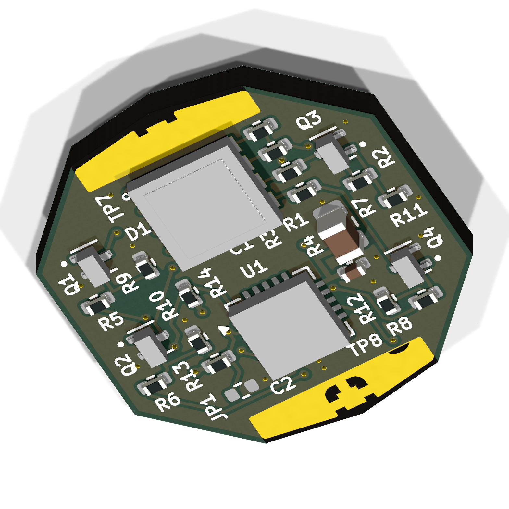

# Lantern Ring v2 RGBW variant

**Experimental RGBW hardware, not physically qualified.** This generated KiCad
10 project uses one four-die RGBW LED and four MOSFET-driven channels. It keeps
the IR board's native outline, 1.6 mm thickness and TP1-TP9 interface. The RGBW
variant uses **four copper layers**, unlike the two-layer IR board: dedicated
In1 GND and In2 VCC planes avoid relying on fragmented outer pours.
The IR board, programming clip and legacy firmware remain unchanged.



[Schematic PDF](generated/schematic.pdf) |
[Top render](generated/top.png) | [Rear render](generated/bottom.png) |
[Top routing](generated/top_routing.svg) |
[Rear routing, mirrored for viewing](generated/bottom_routing.svg) |
[Inner GND](generated/ground_plane.svg) | [Inner VCC](generated/supply_plane.svg) |
[Validation evidence](generated/validation.json)

## Fixed mechanical and programming interface

Use the native [IR PCB](../ring_pcb_IR/ring_pcb_IR.kicad_pcb) as the exact
interface source, not a redraw or an assumed circular envelope.

- Preserve all Edge.Cuts geometry, board thickness (1.6 mm), origin and
  orientation. Do not resize or mirror the board.
- Preserve TP1-TP9 positions, pad shapes/sizes, copper sides, exposed mask
  geometry and electrical assignments, including front TP8 GND for the anvil.
  PB3/PB4 becoming application signals does not change TP4/TP5 assignments.
- Preserve the rear pogo grid (3.05 mm) and off-grid TP9 VCC. Do not substitute
  the ISP header's 2.54 mm pitch for the pogo spacing.
- Reuse the existing [v0.2 programming clip](../ring_ir_prog_clip/README.md)
  and [ArduinoISP harness](../ring_ir_prog_clip/programming.md) without
  rewiring. J1 pins 1-6 remain MISO, VCC, SCK, MOSI, RESET, GND.
- Keep rear contact areas clear of components and preserve front anvil
  contact/clearance regions. The new LED and MOSFET envelopes must be checked
  against the clip window and jaws; matching the outline alone does not prove fit.

The existing [board-layer export](../ring_ir_prog_clip/generated/assembly/ir_board_layers.json)
and [clip geometry](../ring_ir_prog_clip/generated/geometry.json) document
the current interface. The native IR board is authoritative if exports differ.
Do not regenerate the clip to accommodate moved RGBW programming pads.

## ATtiny85 pin allocation

Keep the internal oscillator and PB5 RESET enabled so the same ISP clip works.
The ATtiny85 has three usable independent hardware-PWM output pins for this
allocation, not four: Timer1's complementary outputs are not extra independent
colour channels.

| MCU pin | Existing pad | Circuit use | PWM or input |
| --- | --- | --- | --- |
| PB0 | TP1 / MOSI | Red MOSFET gate | Hardware OC0A |
| PB1 | TP2 / MISO | Green MOSFET gate | Hardware OC0B |
| PB2 | TP3 / SCK | White MOSFET gate | Timer-driven software PWM |
| PB3 | TP4 | Optional colour/mode selector | Digital input or ADC3 |
| PB4 | TP5 | Blue MOSFET gate | Hardware OC1B |
| PB5 | TP6 / RESET | ISP reset only | Do not reclaim as GPIO |
| GND | TP7, TP8 | Ground; TP8 is the anvil contact | Unchanged |
| VCC | TP9 | Programming supply | Unchanged |

Yes, a jumper can select colour: PB3 with a pull-up and a separate jumper or
solder bridge to GND provides two selectable presets/modes. Do not alter the
TP4 pogo pad to make the selector. More choices could use a resistor-coded
ADC3 input with defined voltage bands; this needs tolerance/noise validation.
Read/latch the selector before starting PWM and never leave the input floating.
Without a selector, new firmware can define the palette and sweep behaviour.

Reference: [manufacturer ATtiny25/45/85 datasheet, 2586Q](https://ww1.microchip.com/downloads/en/DeviceDoc/Atmel-2586-AVR-8-bit-Microcontroller-ATtiny25-ATtiny45-ATtiny85_Datasheet.pdf),
Table 10-3, page 60. PB4 is OC1B; PB3 is its complementary output and ADC3.
Timer1 OC1A shares PB1, already used by OC0B. PB2 has no hardware PWM output.

## Implemented circuit

The Cree **CLQ6A-TKW-S1L1R1H1QBB7935BB3** has eight independent
terminals; it is **not internally common-anode**. Copper joins anodes 1-4 to
VCC. R/G/B/W cathodes are 8/7/6/5 respectively. The custom land polygons come
from the recommended pattern in Cree CLD-CT1387 Rev14, page 12, rather than a
generic PLCC footprint. Its 100 mA photometric specifications do not predict
this design's sub-mA brightness or colour.

Each cathode connects through a **2.2k, 1%, 63 mW 0402** resistor to the drain
of a genuine Diodes Incorporated **DMG1012T-7** (SOT523). Source is GND;
each gate has a 1k series resistor and 100k pull-down. The manufacturer's
maximum RDS(on) is specified down to 1.8 V gate drive (0.7 ohm); VGS absolute
maximum is +/-6 V. Do not silently substitute another vendor's same-name part.
The MCU is **ATTINY85-20MU**, with 100n X7R 10 V local bypass, 10u X5R 10 V
bulk capacitance and a 10k RESET pull-up. The [BOM](generated/bom.csv) records
MPNs and distributor search links, not stock or purchase approval.

JP1 is a separate, normally open **0402 bridge footprint**: short it with a
0-ohm 0402 link or a deliberate solder bridge to pull PB3 low. Its external
100k pull-up defines the open state. It is not a fitted pin header and does
not modify TP4. Two settings select two firmware-defined presets/modes; an
ADC ladder for more choices is not implemented.

At the maximum intended 5.5 V bench supply, even a shorted die is bounded by
`5.5 / (2200 * 0.99) = 2.526 mA` per channel. Maximum resistor dissipation is
13.9 mW, below 63 mW. These are conservative electrical bounds, **not CR2032
load/temperature qualification**. ISP can switch the R/G/W gates while RESET
is asserted; firmware cannot prevent that. The resistors remain in circuit.
Use one regulated 5 V programming supply with matching logic levels; remove
the CR2032, never backfeed or charge it. Do not apply 5 V while a cell is fitted.

There is **no boost converter or constant-current driver**. Blue/green/white
may dim or extinguish as the cell discharges. Measure brightness, simultaneous
channel current, battery life and temperatures before treating this as usable
jewellery. The DMG1012T gate network also loads the ISP signals; verify actual
programming on the new assembled variant rather than inheriting the IR result.

## Firmware boundary

- The working 5 V programming report applies to the IR board, not automatically
  this RGBW circuit. Check every new component, LED current limiter and rail for
  the 5 V programming case. Remove the CR2032; never join programming and cell
  supplies or charge the cell.
- Budget total LED/MCU current for a primary CR2032, including simultaneous
  colours. Its resistance is not a current limiter. Blue/green/white forward
  voltage may leave insufficient regulation headroom as the cell discharges;
  determine whether a boost rail is needed before choosing parts.
- Use new RGBW firmware, not edits to Arduino-TV-B-Gone. Plan timer ownership
  for three hardware channels and nonblocking software PWM on PB2; validate
  PWM frequency, endpoint duties, core timing interactions and colour mixing.
  Keep PB3 configured as an input and preserve RESET/SPI fuses.

RGBW firmware is not implemented or flashed by this PCB task. Timer0 owns
OC0A/OC0B (red/green), Timer1 OC1B supplies blue, and white needs nonblocking
timer-driven software PWM on PB2. Validate polarity, frequencies, endpoint
duties, core timing interactions and selector latching on real hardware.

## Sources, rebuild and checks

`parameters.json` defines placements, channel/pin mapping, exact LED lands,
critical VCC/PB2 routes and via positions. `generate.py` reads the native IR board,
generates the schematic and exports KiCad's actual XML netlist before assigning
PCB nets. Edit these sources, **not generated KiCad files**. `finish_route.py`
requires the matching placement/DSN and imports the local SES before refilling
and checking the saved board with KiCad. No electrical-rule exclusions are used.
The four-layer stack must be fabricated at 1.6 mm finished thickness.

```powershell
# Verify saved work without discarding routing:
& hardware\v2.0\ring_pcb_RGBW\build.ps1

# Complete regeneration, local routing, CAD and actual-board renders:
& hardware\v2.0\ring_pcb_RGBW\build.ps1 -Rebuild -Render -FreeroutingJar 'C:\tools\freerouting-2.5.0.jar'

python -m unittest discover -s hardware\v2.0\ring_pcb_RGBW -p test_rgbw.py
```

Requires KiCad 10, FreeCAD's bundled Python and Java for regeneration.
Paths can be overridden with the build parameters. Freerouting 2.5.0 runs
locally with analytics, API and MCP servers off and isolated settings.
The generator first connects supply pads to the inner planes with checked
0.25 mm stubs and places the constrained PB2/SCK escape. The build rejects
any unconnected GND/VCC item before routing. Autorouting handles the remaining
signals; it skips the already connected Power class. This is not a native
electrical-rule exclusion. Router fanout, optimization and automatic neck-down
are disabled; final native DRC rejects any route narrower than 0.15 mm.
Power is 0.25 mm; through-vias are 0.45/0.20 mm diameter/drill.
The footprint is assembly-dense: references use 0.6 mm text/0.12 mm stroke
instead of the larger preferred bench-board text, remain visible, and must
pass DRC. Inspect readability on a fabrication proof.

`generated/erc.json` and `drc.json` are all-severity KiCad reports, including
schematic parity. The final gate requires zero findings, zero unconnected
items and fresh source/artifact hashes. Placement reports intentionally retain
unconnected items before routing; they are not final connectivity evidence.
Portable tests independently parse saved boards/netlists to compare the
native outline, all nine contacts, pad geometry, mask openings, channel
connectivity and foreign-net copper exclusion from exposed contact windows.

The retained raw router log reports 18 DSN-proxy clearance findings and four
unconnected proxy items (GND, VCC and PB2). These are **not a clean router
report**: conservative concave-pad proxies, ideal plane representations and
seed-route interpretation differ from the actual board. After importing the
SES without deleting the native seed routes and refilling real polygons,
KiCad reports **zero violations, zero unconnected items and zero parity
issues**, with no exclusions. `generated/drc.json`, not the router score,
is the final electrical acceptance gate.

`generated/populated.step` is exported from the actual PCB, not redrawn.
`RGBW_checked.FCStd` and `cad-validation.json` validate 65 STEP solids,
require a correctly placed STEP instance for every populated component, and
screen 22 conservative package envelopes against the existing anvil opening.
This is not a full jaw sweep, solder-blob allowance, printed tolerance check,
contact-force analysis or a physical clip-fit qualification.
The smallest nominal screening margin is only **0.189 mm** (R5/R6); the LED
is also close to the upper window edge. These are geometric margins, not
manufacturing tolerance budgets. Verify the assembled parts clear the actual
clip before clamping. The QFN exposed-pad via needs an assembly/stencil
strategy (for example filled/capped via-in-pad); solder wicking is not
qualified by ERC, DRC or these envelope models.

`models/step` vendors KiCad passive models. The LED, QFN and SOT523 models are
locally generated nominal envelopes, with **illustrative** lenses/terminals,
not manufacturer CAD. See `models/led-envelope.json` and
`models/package-models.json`. `create_led_model.py` is their FreeCAD source.
KiCad passive model authorship is retained in the STEP headers; their upstream
source is [KiCad 3D models](https://gitlab.com/kicad/libraries/kicad-packages3D).
They retain their upstream licensing/provenance; the design remains under the
repository's TAPR open-hardware licence. Manufacturer datasheets are linked,
not redistributed. Renders and STEP inputs are hash-bound: changed geometry,
model sources or the rendering build require a fresh `-Render` run.
